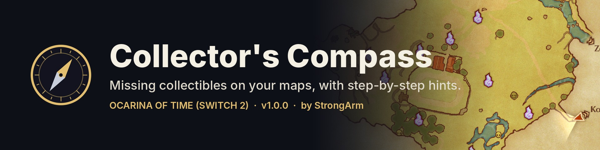
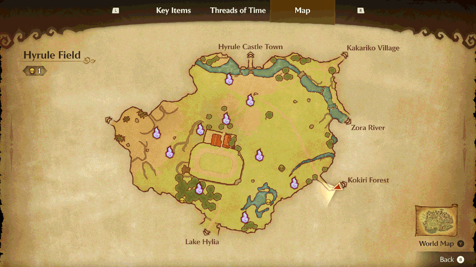
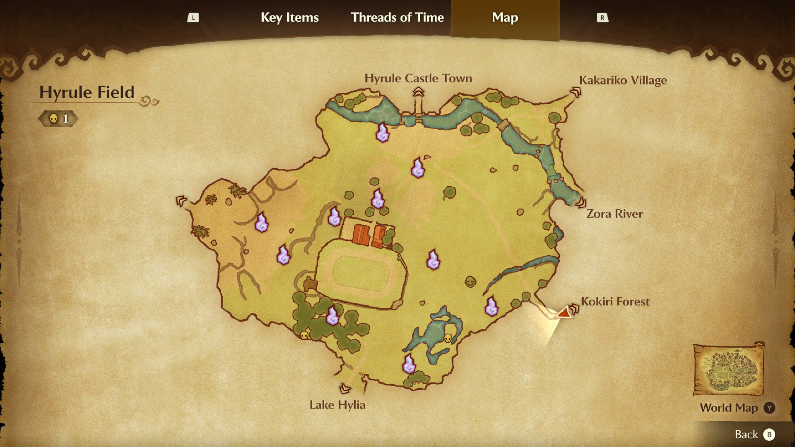
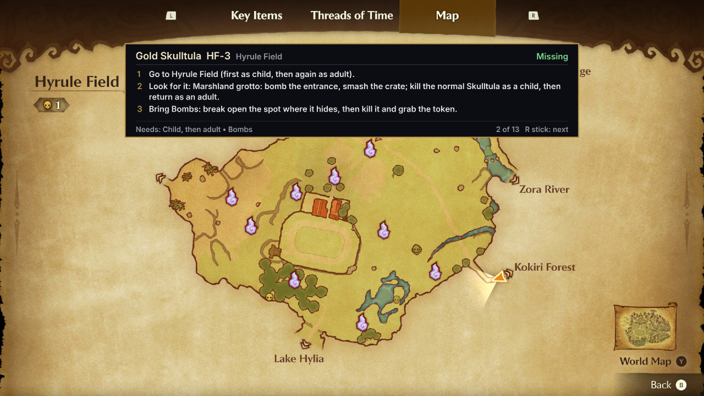
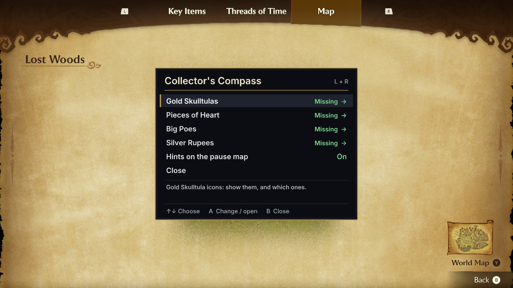

# Collector's Compass



Missing collectibles on your maps, with hints, for Ocarina of Time (Switch 2).

For The Legend of Zelda: Ocarina of Time (Switch 2), version 1.1.1 only: title ID `0400486024DEC000`, executable
build ID `E0F3CCFAF50065AE4EA01EB5AEB13B1A45DA3348`. Tested in the Lichii emulator (Fritchii v5.8.4). Not tested on a
real console.

## What it does



- **Map icons for missing collectibles**, on the minimap and the pause map, using the game's own icon style:
  Gold Skulltulas, Pieces of Heart, Big Poes (with the game's Poe icon) and Silver Rupee rooms (one icon per room
  until all five rupees are collected). Collected ones can be shown faded.
- **Settings menu**: press **L + R together on the pause map**. Each kind of collectible has its own page:
  show on the maps, only what you can get now (age, night, items you have), show collected.
  Settings are saved to the SD card (`OoTMinimapMod/settings.ini`, the folder name from the mod's first test builds).
- **Hints**: on the pause map, tilt the **right stick** to pick an icon (it blinks). A panel shows what it is,
  whether you have it, what it needs and step-by-step directions. Tilt again to move to the next icon.

The mod contains no game files. It changes two of the game's map icon pictures in memory as the game loads them,
and only if they match version 1.1.1 exactly.

| Pause map | Hint panel | Settings |
|---|---|---|
|  |  |  |

## Install

1. Close the game.
2. In Lichii, right-click the game and choose **Open Mod Data Location**.
3. Copy the `Collectors-Compass` folder there. Its `exefs` folder must contain `subsdk9` and
   `E0F3CCFAF50065AE4EA01EB5AEB13B1A45DA3348.ips`.
4. Start the game.

To uninstall, close the game and delete the folder. If you used an earlier test version that had a `romfs`
folder, delete that `romfs` folder: it is no longer needed.

## Compatibility

- **Uses `subsdk9`.** Another mod that also ships a `subsdk9` can't be used at the same time.
- **Hyrule Cheat Menu** and **Fast Travel**: the game starts and runs with all three installed, and this mod's features were tested that way (the other two mods' own features were not re-tested).
- **Memory**: the game sizes its main memory at start-up from what the loaded mods leave free, and won't start
  ("Almost ready..." forever) if mods take too much. This mod reserves very little at start-up (about 0.35 MB) and
  takes its panel images (2 to 8 MB, depending on the screen) from the game's own spare heap later. With Hyrule
  Cheat Menu (about 36 MB) installed, roughly 2 to 4 MB is left for any further mods. Lichii always uses its
  12 GB Switch 2 memory layout for this game, so the memory setting doesn't change this.
- **Map Shows Missing Collectibles** patch file: not needed with this mod (the same change is built in). Leave it off.
- **Map Shows Missing Minigame Hearts** patch file: does something this mod doesn't (the heart badge on minigame
  icons counts the hearts still to win). It wasn't tested together with this mod; leave it off unless you test it.
- **Screens**: tested docked (2560x1440) and handheld (1920x1080), with and without Lichii's Max Resolution patch,
  and at 1x, 1.5x and 3x resolution scale.

## Known limits

- Silver Rupee rooms in Gerudo Training Ground (3) and Ganon's Castle (4) have no map position yet, so no icon.
- The Gerudo Training Ground sign on the adult Gerudo's Fortress map shows a silver rupee (the mod uses that
  picture for Silver Rupee rooms).
- "Only what I can get now" for Big Poes checks adult, the Fairy Bow and a bottle; it doesn't check for Epona.
- Big Poe icons were checked in game on the Hyrule Field map. Silver Rupee room icons were tested on other maps;
  their exact spots in the dungeons have not been seen in game yet.

## Credits and licenses

- Menu font: Inter by Rasmus Andersson, SIL Open Font License (`OFL-Inter.txt`).
- Screen overlay code adapted from Fast Travel, MIT License (`THIRD-PARTY-NOTICES.txt`).
- Collectible locations and directions: compiled from community guides (Zelda Dungeon, finalboss.io, jegged.com
  and others), keeping what they agree on, and checked against the game's own map data.
- The silver rupee picture is original art.

- Made by StrongArm. This mod's code: MIT License (`LICENSE`). Source: https://github.com/strongarm11/collectors-compass

Not affiliated with or endorsed by Nintendo.

## Building from source

You need: an `aarch64-linux-gnu` GCC toolchain (g++ and ld), Python 3 with `pyelftools` and `capstone`, and your own
decompressed `main` of version 1.1.1 (build ID `E0F3CCFA...`), dumped from your own copy of the game.

```
MAIN=/path/to/your/main ./build.sh
```

The output lands in `exefs/`. `generated/` holds pre-made tables (collectibles, the menu font, the in-memory
archive patch), so building needs no other game files. The tools that make them (`tools/gen_*.py`,
`tools/make_icons_*.py`, `tools/build_steps.py`) need data extracted from the game and are kept for reference.
`tools/tests/` are emulator test harnesses that also need your own `main`.

The repository contains no Nintendo code or assets. The offsets and instruction words in `hooks.json` and the source
identify locations in the game's executable and are checked against it.
